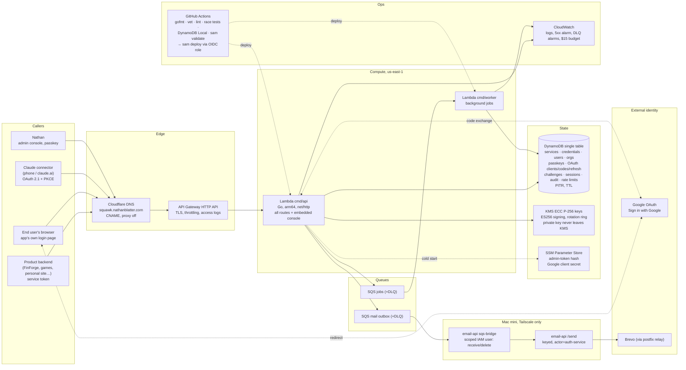

# Squawk

**Squawk** is auth as a service for Nathan's products, "my own Okta". The name is the
transponder code air traffic control assigns so radar knows exactly who you are; Flightdeck
flies the plane, Squawk says who everyone is. Headless API at
`https://squawk.nathanblatter.com`: products register as **services**, get a credential, and
exchange it for short-lived signed tokens. Each service can own a **user pool** (passkeys,
Sign in with Google, emailed sign-in codes), open to the public or invite-only, and Claude
connectors get standard OAuth 2.1 with the owner approving each one by passkey. See
`docs/DESIGN.md` for the full picture and what is decided, `docs/API.md` for every endpoint.

## Architecture



**Request path.** Every route lives in one Go binary behind API Gateway. The Lambda adapts API
Gateway events to `net/http`, so the same handler runs locally (`make dev`) and in prod. Tokens
are ES256 JWTs signed inside KMS; verifiers only need the public JWKS. All state is one
DynamoDB table (point-in-time recovery, TTL on short-lived rows). Email never leaves the Lambda
directly: it is queued, and a bridge on the Mac mini relays it through email-api so every
message still carries an actor and goes through one budget.

**Trust boundaries.** The Lambda role can touch exactly: the table, the signing keys (sign and
public key only), the two queues, two SSM parameters. The bridge's IAM user can only receive
and delete on the mail queue. CI assumes a role via GitHub OIDC scoped to this repo's `main`;
no AWS keys exist in GitHub. Secrets live in SSM and KMS; the repo holds none.

## Why AWS, and not a Cloudflare tunnel into the homelab

Almost everything else of Nathan's runs on the Mac mini behind Cloudflare tunnels, and that
is the default he prefers: free, self-hosted, simple. Auth is the deliberate exception,
decided on day one. The reasons, in order:

1. **Reliability is the product.** If auth is down, every product that uses it is down at
   once: FinForge, the games, the personal site, the Claude connectors. A home box has a
   single power feed, a single ISP, a single disk, and reboots for macOS updates. Lambda,
   API Gateway, DynamoDB and KMS are multi-AZ managed services with no host to patch, and
   DynamoDB PITR means a bad write is recoverable to the second.
2. **Independence from the homelab.** The products this authenticates will not all live at
   home forever; some are meant to be sold. Their login must not depend on Nathan's house
   having power and internet, on the Mac mini being awake, or on one Cloudflare tunnel
   process staying up. The one homelab dependency left, the mail bridge, is deliberately
   asynchronous: if the Mac mini is off, codes queue in SQS for a day and sign-ins by
   passkey and Google keep working.
3. **Key custody.** Signing keys are generated in and never leave KMS. On the Mac mini they
   would be files on a disk in a house, with rotation and access logging left to us.
4. **Blast radius of a compromise.** A homelab box runs a dozen services on one Docker host;
   a hole in any of them is adjacent to the auth database. Here auth has its own account
   boundary, its own least-privilege roles, and an audit trail in CloudWatch that an
   attacker on the Mac mini cannot edit.
5. **Scale without thought.** A connector approval, a burst of sign-ins, or a product that
   takes off costs nothing to prepare for; concurrency and storage are not something to
   provision or babysit.
6. **It is cheap enough to break the rule.** Idle cost is about $1 to $1.50 a month (one KMS
   key, a few hundred thousand DynamoDB and Lambda requests are inside free tiers), with a
   $15 budget alarm as the ceiling. The homelab would not have been meaningfully cheaper for
   this workload, only riskier.

A note on names: the project was born as `auth-service` and renamed Squawk on 2026-10-16. The
repo, module, hostname and docs carry the new name; the AWS plumbing (stack `auth-service-prod`,
its table, queues, alarms, the SSM paths, the deploy role) keeps the old one, because renaming
a CloudFormation stack means recreating every resource including the user table, for no
benefit anyone can see. The flightdeck project slug also stays `auth-service`.

What was *not* chosen, and why: Route 53 for DNS (Cloudflare already holds the zone, a CNAME
with proxy off is enough and keeps one DNS story); a separate staging environment (rejected:
local DynamoDB plus the CI gates cover it at this scale); containers on ECS or a VM (a
long-running host to patch for an idle-most-of-the-time service); a hosted IdP like Auth0 or
Cognito (this is the résumé project, and the design is meant to be understood end to end).
The architecture stays portable: the Go binary is plain `net/http`, the store is an interface
with a DynamoDB and an in-memory implementation, and the signer is an interface with KMS and
local ECDSA behind it, so a move to any other host is a new store and signer, not a rewrite.

## Run locally

```sh
make dev            # DynamoDB Local in Docker + the API on http://localhost:4400
make check          # gofmt, vet, lint, tests (what CI runs)
```

Open http://localhost:4400/admin for the console. First visit asks for the admin token from
`.env` to register a passkey (Touch ID works on localhost); after that it's passkey only, with
the token kept as break-glass. Or drive the API directly:

```sh
AUTH=http://localhost:4400
TOKEN=dev-admin-token

# register a service
curl -s -X POST $AUTH/admin/services -H "Authorization: Bearer $TOKEN" \
  -H 'Content-Type: application/json' -d '{"name":"FinForge","slug":"finforge"}'

# mint a credential (the "credential" field is shown exactly once)
curl -s -X POST $AUTH/admin/services/<id>/credentials -H "Authorization: Bearer $TOKEN"

# exchange it for a 15-minute service token
curl -s -X POST $AUTH/v1/token -d grant_type=client_credentials \
  -d client_id=<id> -d client_secret=nbk_...

# use the token
curl -s $AUTH/v1/me -H "Authorization: Bearer <access_token>"
```

## End users

A service with a login URL becomes a user pool: its own app signs people in with passkeys,
Google or an emailed 6-digit code through `/v1/users*` and `/v1/login/*` (service token), and
gets ordinary OAuth tokens for them. `open_signup` decides whether anyone may create an
account (the games) or only the owner may (the personal site). App-created passkey accounts
verify their email with a code before they can sign in. The owner needs no account in any
pool: owner passkeys bind to the parent domain, so every login page can offer "Sign in as
owner" and get a token with `sub=owner`. See docs/API.md "End users" and docs/DESIGN.md
"End users".

**Teams.** Users of a pool can found organisations (a practice, a company) and add members
with an org role, `admin` or `member`, through `/v1/orgs*`, or invite an address by email
(the invite becomes a membership when that person signs in). An app asks for an org context
with `org=` on the authorize request, or switches with `org=` on a refresh, and the tokens
carry `org` + `org_role`; non-members cannot complete the sign-in. See docs/API.md "Teams and
organisations".

## Endpoints

Full reference with request and response shapes: [docs/API.md](docs/API.md).

| Method | Path | Auth | Purpose |
|---|---|---|---|
| GET | `/health` | none | liveness, version, key count |
| GET | `/.well-known/jwks.json` | none | public signing keys |
| GET | `/.well-known/openid-configuration` | none | discovery |
| POST | `/v1/token`, `/oauth/token` | client | `client_credentials`, `authorization_code`, `refresh_token` |
| GET | `/.well-known/oauth-authorization-server` | none | RFC 8414 metadata for connectors |
| POST | `/oauth/register` | none | RFC 7591 dynamic client registration |
| GET | `/oauth/authorize` | none | code + PKCE; parks the request, sends you to the console |
| GET/POST | `/admin/authorize/{id}[/approve\|/deny]` | admin (approve: passkey) | review / decide a connection request |
| POST | `/admin/services/{id}/resources` | admin | register an RFC 8707 resource URL (MCP endpoint) |
| PUT | `/admin/services/{id}/permissions` | admin | set the scope catalog and roles |
| GET | `/v1/me` | service token | who am I |
| GET | `/admin` | none | the owner console (passkey sign-in) |
| GET | `/admin/session` | none | signed in? setup needed? |
| POST | `/admin/login/begin`, `/admin/login/finish` | none | passkey sign-in ceremony |
| POST | `/admin/logout` | cookie | end the session |
| GET/POST | `/admin/passkeys[/begin\|/finish]` | admin | list / register passkeys |
| GET/POST | `/admin/recovery-codes` | admin | status / generate a new set (shown once) |
| POST | `/admin/recover` | none | sign in with a recovery code (recovery session) |
| POST | `/admin/logout-everywhere` | admin | kill all sessions and connector refresh tokens |
| POST | `/admin/step-up/begin`, `/finish` | passkey session | re-verify with Face ID for sensitive actions |
| GET | `/admin/audit?month=YYYY-MM` | admin | page the audit log, newest first |
| POST | `/admin/services` | admin | register a service |
| GET | `/admin/services[/{id}]` | admin | list / fetch |
| POST | `/admin/services/{id}/credentials` | admin, fresh | mint (shown once) |
| GET | `/admin/services/{id}/credentials` | admin | list by last four |
| DELETE | `/admin/services/{id}/credentials/{cred}` | admin | revoke |

"admin" in the Auth column means a passkey session cookie or the interim admin bearer token;
"fresh" means the passkey was used within the last 5 minutes (the console re-prompts Face ID).

## Verifying a token in your service

Go: `go get github.com/nathanblatter/squawk/client` and see [client/README.md](client/README.md).
Standard library only; verifies tokens against a cached JWKS and wraps the credential exchange.

Anything else: fetch `/.well-known/jwks.json`, pick the key by the token's `kid`, verify
ES256, then check `iss`, `aud`, `exp`.

## Deploy

Push to `main`. GitHub Actions runs the checks, then `sam deploy` through an OIDC role.
There are no AWS keys in GitHub. First-time account setup is in `infra/bootstrap/`: the OIDC
provider and deploy role (`github-oidc.yaml`) and the mail bridge's IAM user
(`mailbridge.yaml`), both deployed by hand once because the CI role deliberately cannot
manage IAM.
